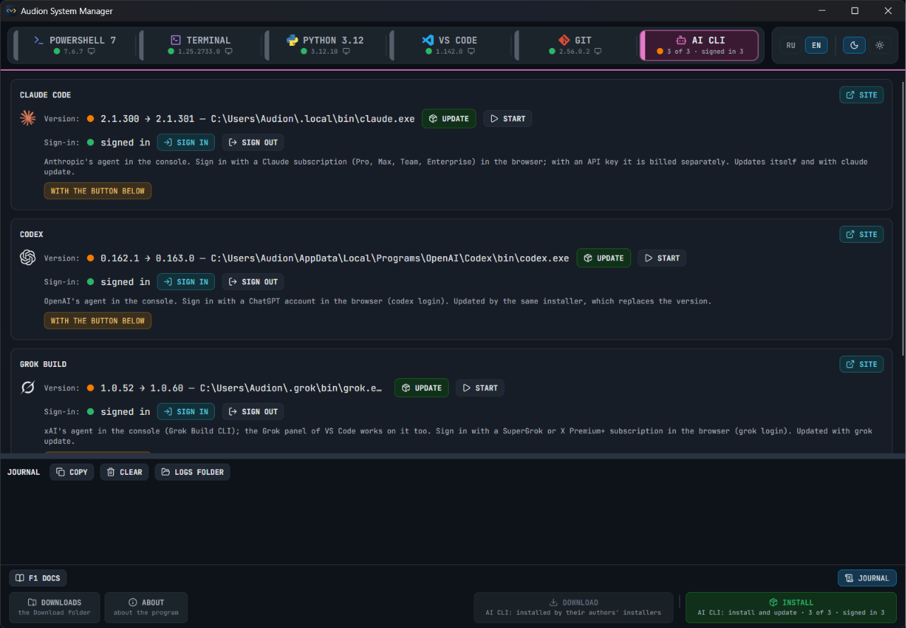

# Audion System Manager

<!-- audion:release -->

  
  
  
  

**Version 1.1.0** · 2026-10-16 · 49.3 MB

- [Direct download](https://audion.dev/get/system-manager/1.1.0/Audion_System_Manager_v1.1.0_Full.zip) — unmetered, no rate limits
- [Project page](https://audion.dev/downloads/system-manager) — every version and how to install

`SHA-256: bff34fad108eef642a592fe2d2ef0887ccb1a1a03a1a61a633e30c48839cfe70`

---

An **Audion** tool, published by [Tensionix](https://github.com/Tensionix).
<!-- /audion:release -->

[English README](Docs/README_EN.md) · [User Guide](Docs/USER_GUIDE_EN.md) | [Русский README](Docs/README_RU.md) · [Руководство](Docs/USER_GUIDE_RU.md)

One window for the developer environment on Windows: **PowerShell 7**, **Windows Terminal**, **Python 3.12**, **VS Code**, **Git** with **GitHub CLI**, and the agents of the console **Claude Code**, **Codex**, **Grok Build**. Each program can be installed for the system or unpacked as a portable folder — with every option a package manager does not give, and with the Audion settings. With buttons: no black console window, no command-line switches.

## Why

A package manager installs a program but does not set it up. An installer wizard offers options nobody remembers half a year later. And the settings after the install are put together again on every machine. The program takes all of that on itself.

| Section | For the system | Portable |
|---|---|---|
| POWERSHELL 7 | the MSI for the whole machine with every option: Explorer menus, PATH, event log, updates through Microsoft Update; the Audion profile | the zip of the release in a folder |
| TERMINAL | Windows Terminal from the Store (or through WinGet) and the Audion settings in every terminal found; the default terminal; Cascadia Nerd Font | the zip of the release in a folder, settings beside it |
| PYTHON 3.12 | the python.org installer for all users, into its own folder, the path at the front of PATH, the py launcher, no Store stubs; pip of every Python | python.org's full archive with pip |
| VS CODE | the installer for the machine or the profile with every box of its wizard, the settings, keys and snippets, the extensions by the lists | the archive in a folder with its data folder, updated without losing the settings |
| GIT | Git for Windows with every box of its wizard; GitHub CLI with sign-in in the browser; the Audion Git settings, the personal ones left alone | PortableGit in a folder, GitHub CLI beside it |

The **AI CLI** section installs and updates Claude Code, Codex and Grok Build with their authors' installers, and signs in and out with your subscription (OAuth in the browser) by a button for each.

Administrator rights are asked for only for an install for the whole machine — by the UAC prompt of the installer. Downloads go to `Download`, portable builds to `Portable`: **the folder can be carried to another machine whole**.

## Starting

`Start.exe`. The details are in the [user guide](Docs/USER_GUIDE_EN.md).
